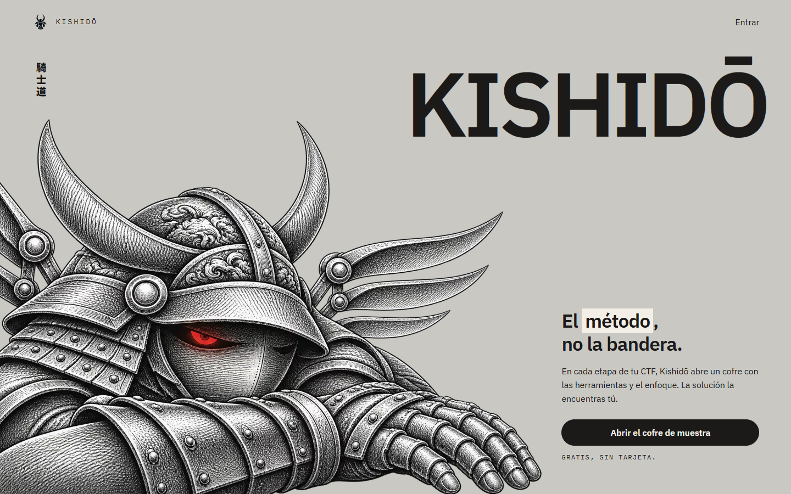
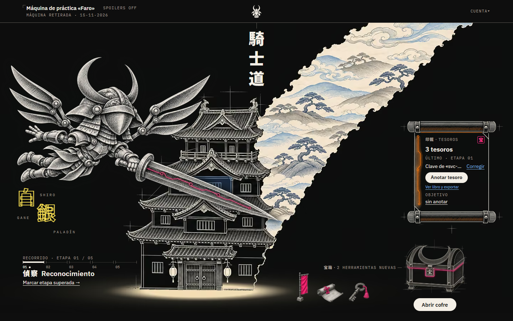
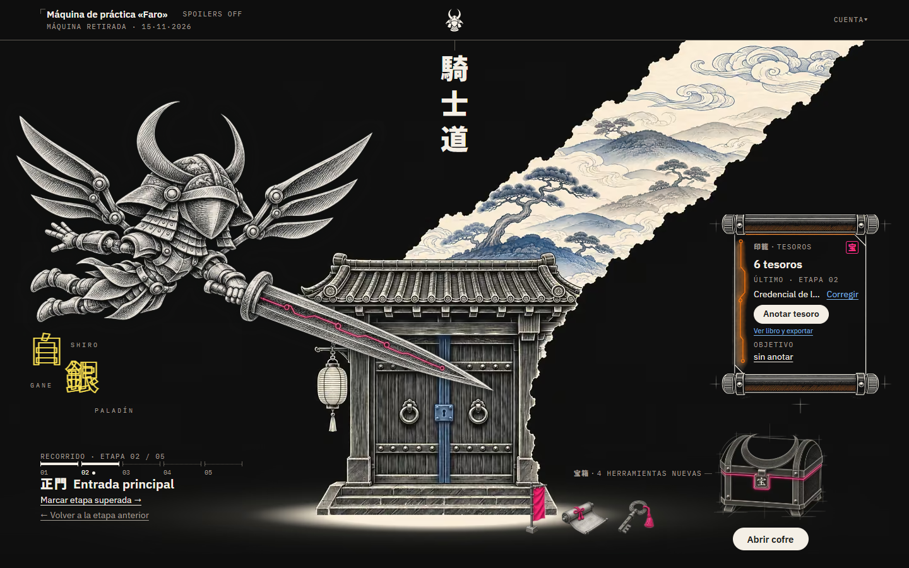
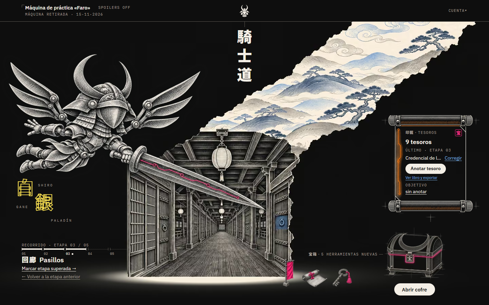
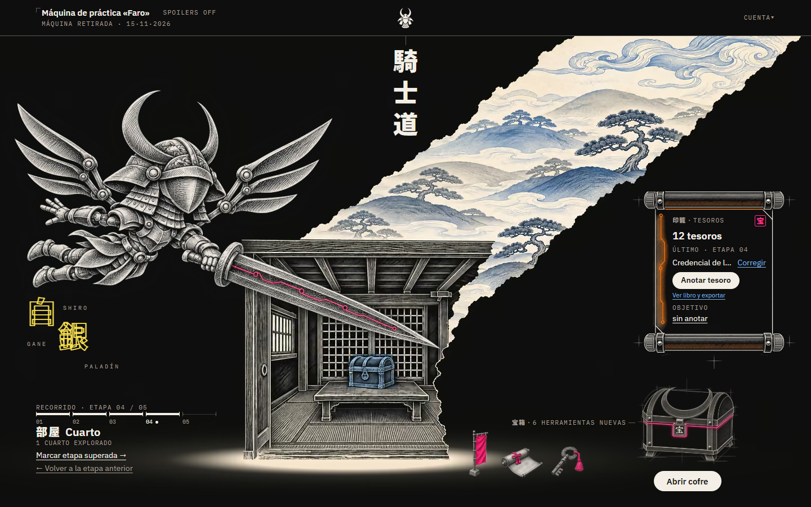
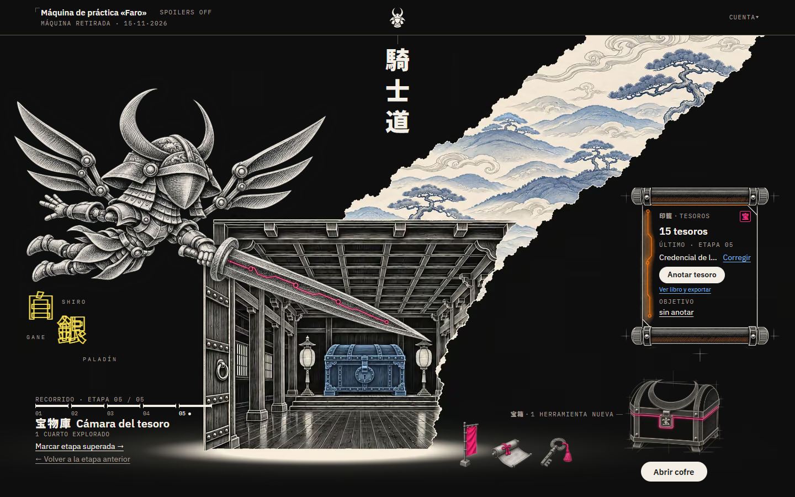
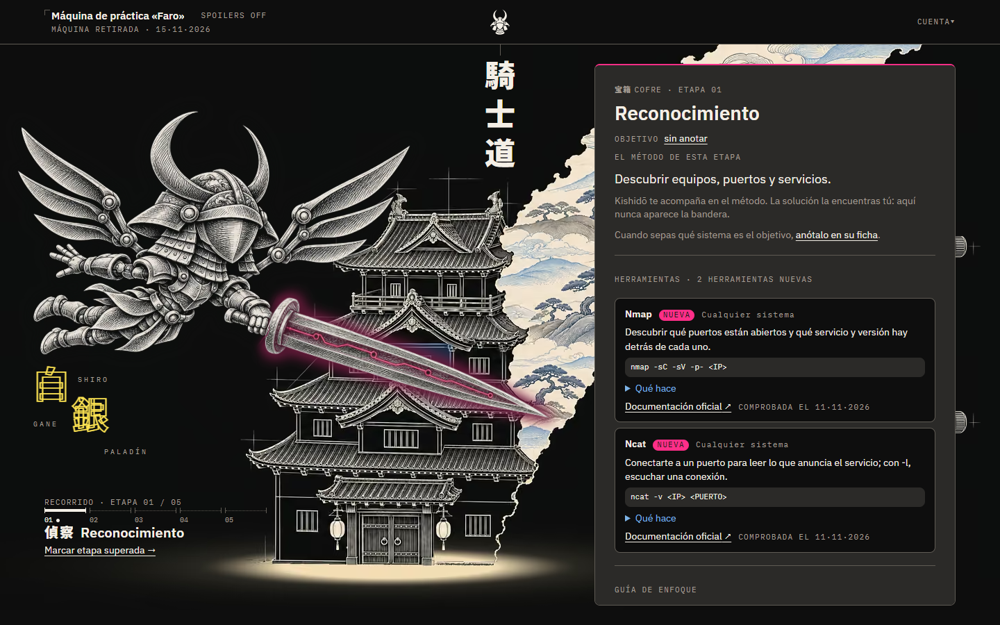
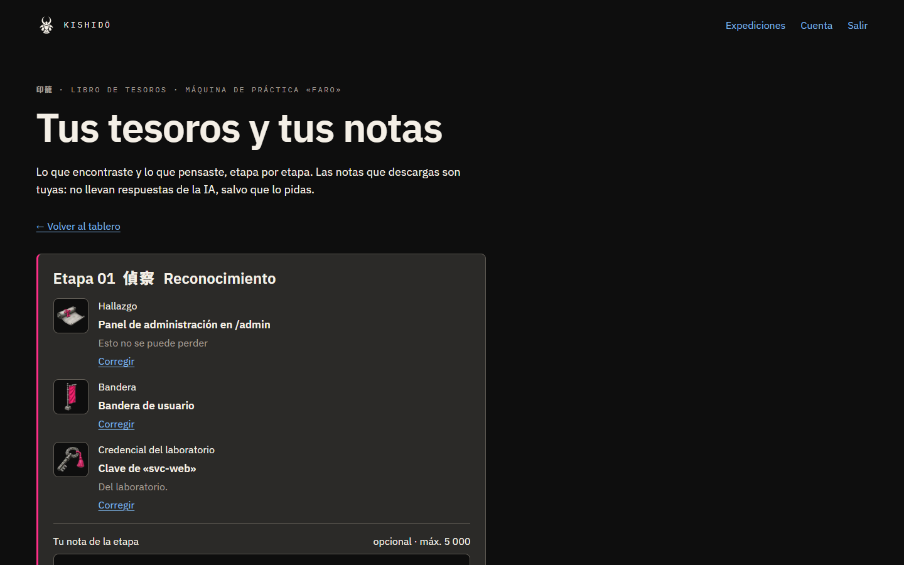
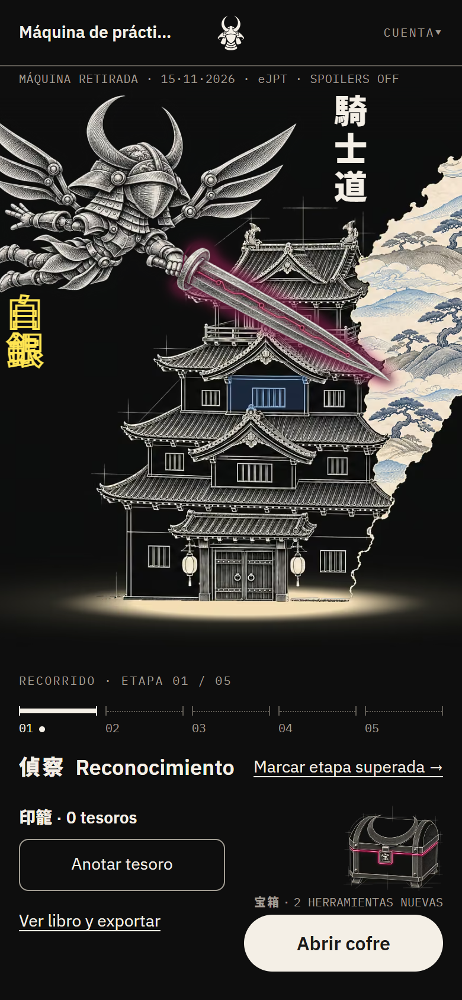

# Kishidō · 騎士道

**Un acompañante para aprender ciberseguridad practicando: te guía por etapas mientras
resuelves un reto, sin darte la solución, y guarda tus notas.**

Y, con el mismo peso, lo que **no** hace: no aloja laboratorios, no entrega banderas y no
es una herramienta contra sistemas reales.

 

La portada del programa en marcha. Todas las capturas son del producto real, con datos
de práctica inventados.

> **In English.** Kishidō is a companion for people learning offensive security through
> practice challenges (CTFs and retired training machines). It walks the learner through
> five stages, shows which tools fit the stage they are in, with their official
> documentation and a short focus guide, and keeps their findings as notes they can export
> as Markdown. Spoiler-free AI guidance on pasted terminal output is built and tested
> against a simulated model; it will be switched on once it passes its evaluation set. It
> does not host labs, it never hands over the flag, and every expedition starts with the
> learner confirming they are authorized to practice on that environment. Spanish-first,
> for desktop and mobile. Built with Java 25, Spring Boot 4 and PostgreSQL. The MVP is
> complete and tested locally; it is not deployed yet.

---

## El problema

Quien empieza en ciberseguridad ofensiva se atasca pronto, y las dos salidas habituales
le enseñan poco: mirar la solución completa de otro, o pedirle a un chatbot que resuelva
el reto. En los dos casos el reto queda resuelto y la persona no aprendió a pensar el
siguiente paso. Además, casi todo el material de apoyo está en inglés.

## Qué hace Kishidō

| | |
|---|---|
| **1 · Ordena el reto en cinco etapas** | Reconocimiento, entrada, pasillos, cuarto y cámara. Siempre se sabe en qué punto se está y qué queda |
| **2 · Abre el cofre de la etapa** | Un catálogo fijo de herramientas para esa etapa, cada una con su documentación oficial, y una guía de enfoque. Funciona aunque la IA no esté disponible |
| **3 · Orienta sin spoilers** | El aprendiz pega la salida de su terminal y recibe una pista sobre cómo leerla y qué mirar después. Nunca la bandera ni el paso exacto. Está construida y probada contra un modelo simulado; se encenderá cuando pase su conjunto de evaluación |
| **4 · Guarda los tesoros** | Cada hallazgo se anota en su etapa, y se cuenta cuántos cuartos se han explorado. Se pueden llevar varias expediciones a la vez, cada una con lo suyo |
| **5 · Exporta las notas** | En Markdown, y sin el texto de la IA por defecto: las notas son de quien las escribió |

## El tablero

El centro de la pantalla es **Shirogane** (白銀), un paladín de armadura plateada. Su
espada señala siempre el cofre, que es la acción principal. Detrás, la mazmorra cambia
de escena con cada etapa del recorrido.

<table>
<tr>
<td width="50%"></td>
<td width="50%"></td>
</tr>
<tr>
<td><b>01 · Reconocimiento.</b> Se mira el objetivo desde fuera: qué hay y qué está expuesto.</td>
<td><b>02 · Entrada.</b> Se ha encontrado una puerta. La parte en azul marca dónde mirar.</td>
</tr>
<tr>
<td></td>
<td></td>
</tr>
<tr>
<td><b>03 · Pasillos.</b> Ya dentro, con muchas puertas por probar.</td>
<td><b>04 · Cuarto.</b> Una puerta cedió y dentro hay algo de valor. Después se vuelve al pasillo.</td>
</tr>
<tr>
<td></td>
<td></td>
</tr>
<tr>
<td><b>05 · Cámara.</b> El final del recorrido.</td>
<td></td>
</tr>
</table>

Capturas del tablero real a 1440 × 900, en una expedición de prueba con sus tesoros. El
arte es propio del proyecto.

## Más pantallas

<table>
<tr>
<td width="50%"></td>
<td width="50%"></td>
</tr>
<tr>
<td><b>El cofre.</b> Las herramientas de la etapa, con su documentación oficial, y una guía de enfoque. Funciona sin IA.</td>
<td><b>El libro de tesoros.</b> Todo lo encontrado, etapa por etapa, listo para exportar en Markdown.</td>
</tr>
<tr>
<td></td>
<td></td>
</tr>
<tr>
<td><b>En el móvil.</b> El mismo tablero, recompuesto para una pantalla vertical.</td>
<td></td>
</tr>
</table>

## Principios

- **Nunca da la bandera.** La orientación ayuda a pensar el siguiente paso; no resuelve el reto.
- **Solo entornos autorizados.** Cada expedición empieza confirmando que se practica sobre un entorno permitido: un CTF, un laboratorio propio o una máquina de práctica.
- **El cofre funciona sin IA.** Las herramientas y las preguntas de cada etapa no dependen de un proveedor externo.
- **Las notas son tuyas.** Se exportan, se descargan con el resto de tus datos y se borran con la cuenta.
- **Sin cifra inventada.** Cada herramienta lleva su documentación oficial y la fecha en que se comprobó.
- **No promete resultados.** No promete aprobar un examen ni conseguir un empleo.
- **No sustituye a las plataformas.** Acompaña al aprendiz mientras practica en ellas; no aloja máquinas ni retos.

## Stack

Java 25 · Spring Boot 4 · Thymeleaf + HTMX · PostgreSQL · Flyway. El núcleo con las
reglas del producto es Java puro, separado de la web y de la base de datos.

## Estado

**El MVP está terminado y probado en local.** Tiene la portada, el acceso por enlace al
correo, varias expediciones a la vez y el tablero en escritorio y en móvil. También el
cofre de cada etapa, los tesoros y las notas, la exportación en Markdown, y la descarga y
el borrado de los datos propios. Cada persona ve las fechas en la zona horaria de su
navegador. La orientación con IA está construida y probada contra un modelo simulado: se encenderá
cuando pase su conjunto de evaluación.

Cada regla del producto tiene su comprobación automática: pruebas unitarias y de
integración, pruebas de mutación del filtro de banderas y recorridos en un navegador real
con comprobaciones de accesibilidad.

Falta el despliegue: todavía no hay un sitio público. Este repositorio se actualiza en
hitos.

## Licencia

Software propietario. Este repositorio publica **solo** una presentación (texto e
imágenes); no contiene código fuente y su visibilidad no concede ningún derecho de uso.
Ver [LICENSE](LICENSE).

Kishidō es un proyecto independiente. No está afiliado ni avalado por ninguna plataforma
de práctica ni por ningún organismo de certificación; los nombres de terceros pertenecen
a sus propietarios.

© 2026 Rubén Agudelo Alzate · Hecho en Medellín, Colombia.
