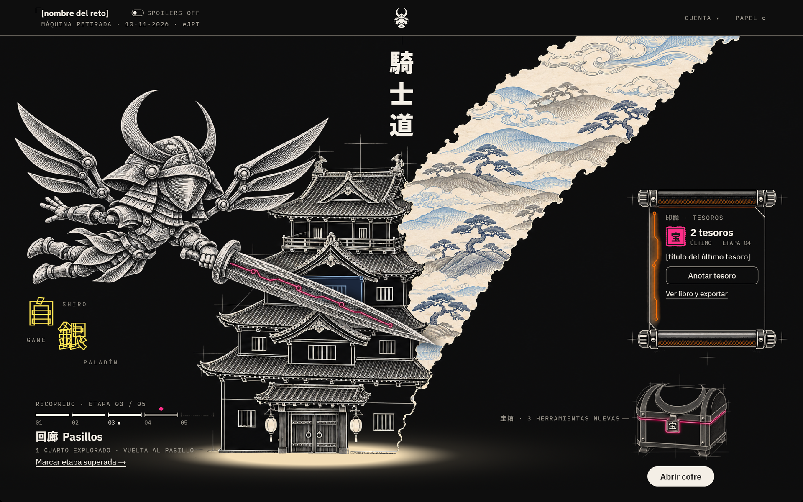
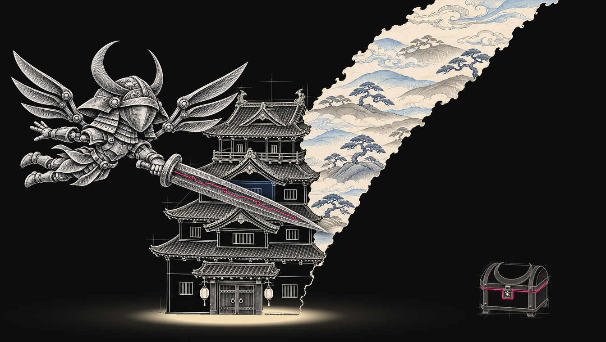
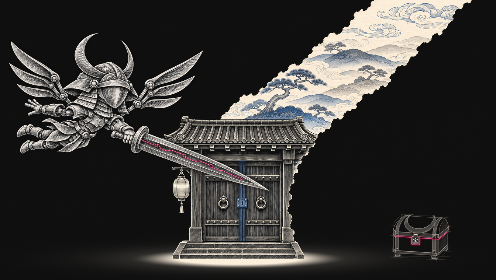
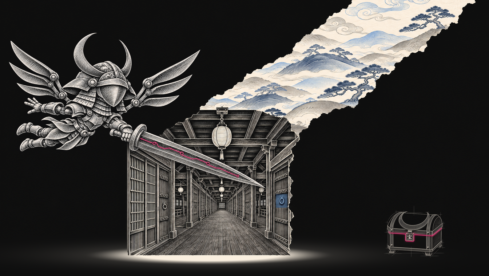
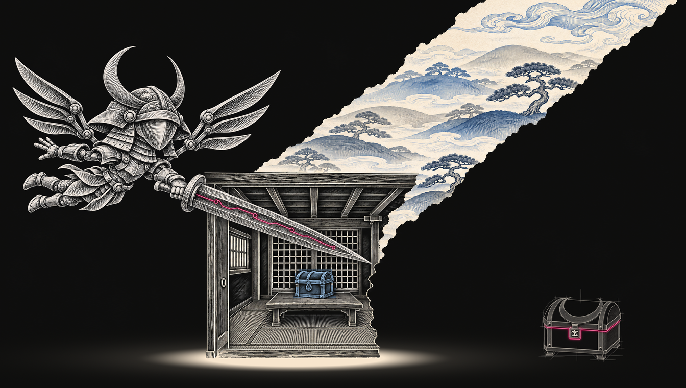
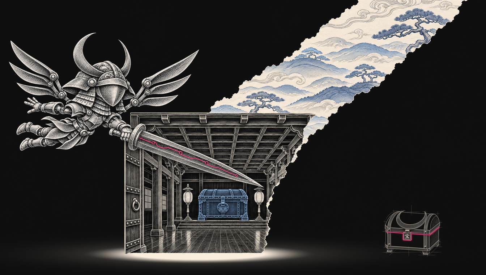

# Kishidō · 騎士道

**Un acompañante con IA para aprender ciberseguridad practicando: te orienta por etapas
mientras resuelves un reto, sin darte la solución, y guarda tus notas.**

Y, con el mismo peso, lo que **no** hace: no aloja laboratorios, no entrega banderas y no
es una herramienta contra sistemas reales.

 

Diseño aprobado de la pantalla principal (mockup). El programa está en construcción:
todavía no hay capturas del producto real.

> **In English.** Kishidō is an AI companion for people learning offensive security
> through practice challenges (CTFs and retired training machines). It walks the learner
> through five stages, suggests which tools fit the stage they are in, and gives
> spoiler-free guidance on the output they paste, so they keep solving the challenge
> themselves. It keeps their findings as notes they can export as Markdown. It does not
> host labs, it never hands over the flag, and it only works on environments the learner
> is authorized to practice on. Spanish-first. Built with Java 25, Spring Boot 4 and
> PostgreSQL. Currently in development: what you see here is the approved design, not
> the running product.

---

## El problema

Quien empieza en ciberseguridad ofensiva se atasca pronto, y las dos salidas habituales
le enseñan poco: mirar la solución completa de otro, o pedirle a un chatbot que resuelva
el reto. En los dos casos el reto queda resuelto y la persona no aprendió a pensar el
siguiente paso. Además, casi todo el material de apoyo está en inglés.

## Qué hace Kishidō

| | |
|---|---|
| **1 · Ordena el reto en cinco etapas** | Reconocimiento, entrada, pasillos, cuarto y cámara. Siempre se sabe en qué punto se está y qué queda |
| **2 · Abre el cofre de la etapa** | Un catálogo fijo de herramientas para esa etapa, cada una con su documentación oficial, y una guía de enfoque. Funciona aunque la IA no esté disponible |
| **3 · Orienta sin spoilers** | El aprendiz pega la salida de su terminal y recibe una pista sobre cómo leerla y qué mirar después. Nunca la bandera ni el paso exacto |
| **4 · Guarda los tesoros** | Cada hallazgo se anota en su etapa, y se cuenta cuántos cuartos se han explorado |
| **5 · Exporta las notas** | En Markdown, y sin el texto de la IA por defecto: las notas son de quien las escribió |

## El tablero

El centro de la pantalla es **Shirogane** (白銀), un paladín de armadura plateada. Su
espada señala siempre el cofre, que es la acción principal. Detrás, la mazmorra cambia
de escena con cada etapa del recorrido.

<table>
<tr>
<td width="50%"></td>
<td width="50%"></td>
</tr>
<tr>
<td><b>01 · Reconocimiento.</b> Se mira el objetivo desde fuera: qué hay y qué está expuesto.</td>
<td><b>02 · Entrada.</b> Se ha encontrado una puerta. La parte en azul marca dónde mirar.</td>
</tr>
<tr>
<td></td>
<td></td>
</tr>
<tr>
<td><b>03 · Pasillos.</b> Ya dentro, con muchas puertas por probar.</td>
<td><b>04 · Cuarto.</b> Una puerta cedió y dentro hay algo de valor. Después se vuelve al pasillo.</td>
</tr>
<tr>
<td></td>
<td></td>
</tr>
<tr>
<td><b>05 · Cámara.</b> El final del recorrido.</td>
<td></td>
</tr>
</table>

Todas las imágenes son arte propio del proyecto, montado sobre el diseño aprobado.
No son capturas del programa.

## Principios

- **Nunca da la bandera.** La orientación ayuda a pensar el siguiente paso; no resuelve el reto.
- **Solo entornos autorizados.** Cada expedición empieza confirmando que se practica sobre un entorno permitido: un CTF, un laboratorio propio o una máquina de práctica.
- **El cofre funciona sin IA.** Las herramientas y las preguntas de cada etapa no dependen de un proveedor externo.
- **Las notas son tuyas.** Se exportan, se descargan con el resto de tus datos y se borran con la cuenta.
- **Sin cifra inventada.** Cada herramienta lleva su documentación oficial y la fecha en que se comprobó.
- **No promete resultados.** No promete aprobar un examen ni conseguir un empleo.
- **No sustituye a las plataformas.** Acompaña al aprendiz mientras practica en ellas; no aloja máquinas ni retos.

## Stack

Java 25 · Spring Boot 4 · Thymeleaf + HTMX · PostgreSQL · Flyway. El núcleo con las
reglas del producto es Java puro, separado de la web y de la base de datos.

## Estado

En desarrollo. Están cerrados el estudio previo, la marca, el diseño del tablero y la
arquitectura; la construcción empieza por los cimientos (compilación, pruebas, datos y
seguridad). La primera versión será una aplicación web en español, para escritorio.

Este repositorio se actualiza en hitos: cuando exista el programa, estas imágenes se
cambiarán por capturas reales.

## Licencia

Software propietario. Este repositorio publica **solo** una presentación (texto e
imágenes); no contiene código fuente y su visibilidad no concede ningún derecho de uso.
Ver [LICENSE](LICENSE).

Kishidō es un proyecto independiente. No está afiliado ni avalado por ninguna plataforma
de práctica ni por ningún organismo de certificación; los nombres de terceros pertenecen
a sus propietarios.

© 2026 Rubén Agudelo Alzate.
